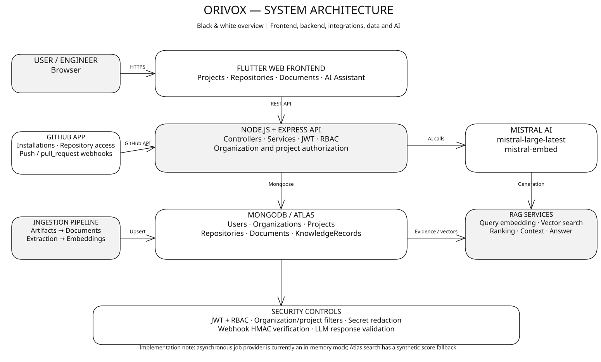
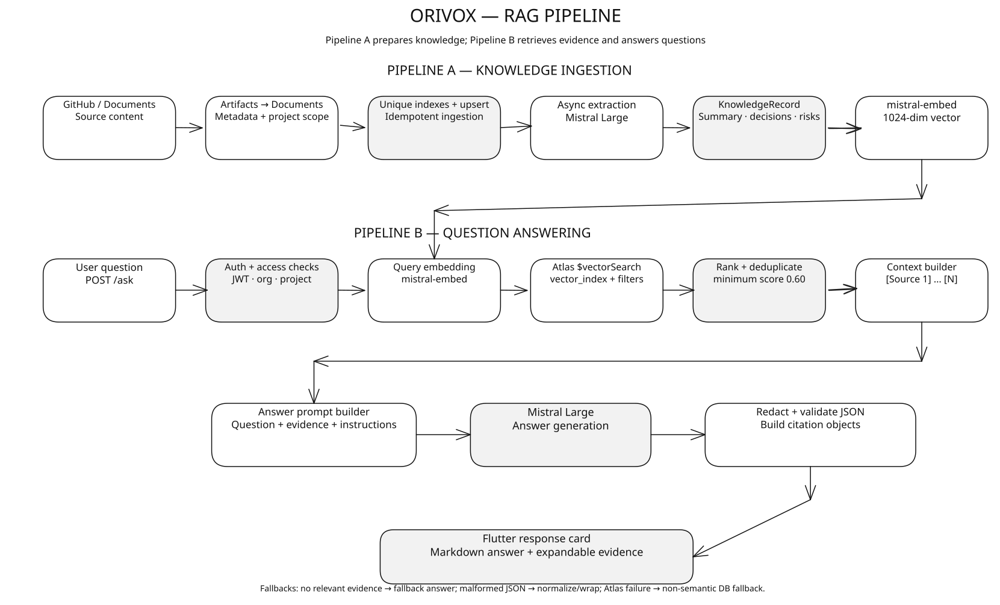

# Orivox --- Engineering Knowledge Discovery and Retrieval System

Orivox helps engineering teams find the knowledge behind their code. It
collects information from software repositories and uses AI-powered
retrieval to help engineers ask questions and find answers grounded in
relevant project context.

## What it does

-   Connects with GitHub to collect repository information.
-   Organizes engineering knowledge so it is easier to search and reuse.
-   Uses retrieval-augmented generation (RAG) to answer questions using
    relevant project context.
-   Keeps information scoped by organization and project.
-   Provides source references so users can trace answers back to
    supporting evidence.

## Architecture

### System overview



The frontend communicates with the backend API. The backend handles
access checks, repository ingestion, knowledge processing, retrieval,
and answer generation.

### GitHub integration


Orivox uses GitHub App credentials to access authorized repositories.
Webhook signatures are checked separately to verify incoming GitHub
events.

### RAG pipeline



The pipeline prepares knowledge from repository content, creates
embeddings, retrieves relevant records for a question, and uses that
context to generate an answer with supporting references. If there is
not enough evidence, the system is designed to use a fallback response
rather than invent an answer.

## Tech stack

-   **Backend:** JavaScript, Node.js, Express.js
-   **Frontend:** Flutter
-   **Database and search:** MongoDB Atlas and Atlas Vector Search
-   **AI:** Mistral models for knowledge extraction, embeddings, and
    answer generation
-   **Source integration:** GitHub App and GitHub API

## Getting started

### Clone the repository

Replace the placeholders with your actual repository URL and folder
name.

``` bash
git clone <YOUR_REPOSITORY_URL>
cd <YOUR_REPOSITORY_DIRECTORY>
```

### Run the backend

``` bash
cd backend
pnpm install
```

Create a `backend/.env` file with the values required by your
application. For a basic local setup:

``` env
PORT=3000
NODE_ENV=development
MONGO_URI=mongodb://localhost:27017/orivox
```

Start MongoDB locally or use your MongoDB Atlas connection string. Add
any other variables your app needs, such as AI, authentication, or
GitHub credentials. Do not commit secrets.

Start the development server:

``` bash
pnpm dev
```

### Set up the Flutter frontend

From the Flutter project directory, run:

``` bash
flutter doctor
flutter pub get
```

## Deploy Flutter Web with Firebase Hosting

1.  Install and sign in to the Firebase CLI:

    ``` bash
    npm install -g firebase-tools
    firebase login
    ```

2.  Create or select a project in the [Firebase
    Console](https://console.firebase.google.com/).

3.  From the Flutter project directory, initialize Hosting:

    ``` bash
    firebase init hosting
    ```

    Select your Firebase project and enter `build/web` as the public
    directory. Enable single-page app rewrites if needed for your
    routing.

4.  Build and deploy:

    ``` bash
    flutter build web --release
    firebase deploy --only hosting
    ```

Firebase CLI will display the deployed URL. This deploys the frontend;
the backend must be hosted separately.

## Build Android releases

From the Flutter project directory, build an APK for testing or direct
installation:

``` bash
flutter build apk --release
```

For Google Play Store submission, build an Android App Bundle:

``` bash
flutter build appbundle --release
```

Typical output paths:

-   APK: `build/app/outputs/flutter-apk/app-release.apk`
-   App Bundle: `build/app/outputs/bundle/release/app-release.aab`

Make sure signing and version details are configured before publishing.

## API health check

If the backend is running on port `3000`, check its health endpoint:

``` bash
curl http://localhost:3000/api/v1/health
```
